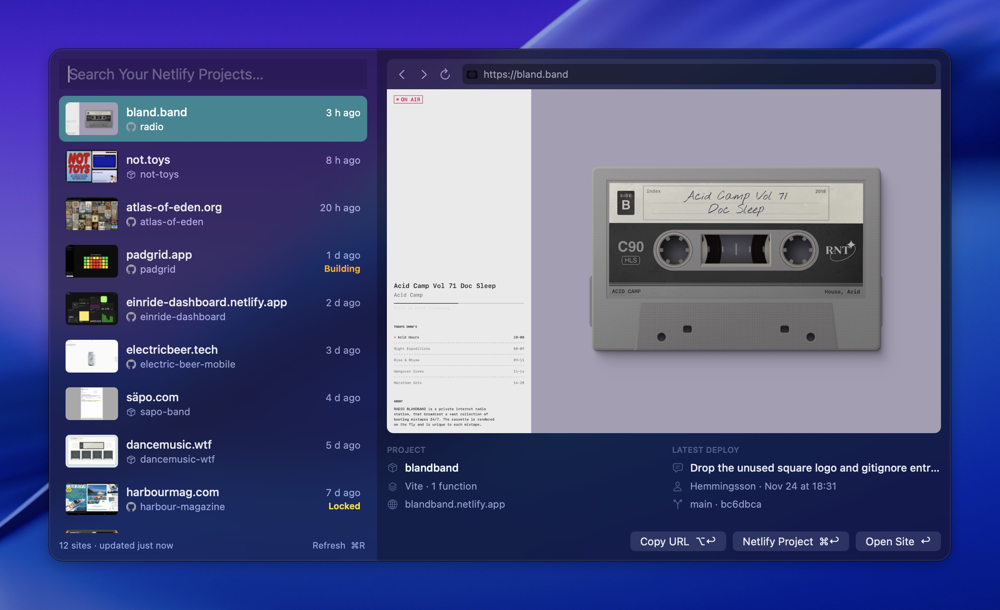

<picture>
  <source media="(prefers-color-scheme: dark)" srcset="assets/netlifylogo-light.png">
  <source media="(prefers-color-scheme: light)" srcset="assets/netlifylogo-dark.png">
  
</picture>

# Netlify for Alfred

Browse your Netlify sites from Alfred. Search by name, domain or repo, preview a site and check its latest deploy.



Requires **Alfred 6 with Powerpack** and **macOS 14 or later**. Works on Apple Silicon and Intel Macs. No Python, Node.js or other runtime needed.

## Install

1. [Download Netlify.alfredworkflow](https://github.com/Hemmingsson/alfred-netlify-workflow/releases/latest/download/Netlify.alfredworkflow).
2. Open the file to install it in Alfred.
3. Type `net`, click **Sign in to Netlify**, and approve access in your browser.

The download is signed with Developer ID and notarised by Apple. To update, install the latest download. Alfred keeps your workflow settings.

## Use

| Input | Action |
|---|---|
| `net` | open the window (`net blog` opens it filtered) |
| type | filter by name, domain or repo |
| <kbd>↩</kbd> | open the site |
| <kbd>⌘</kbd><kbd>↩</kbd> | open the project on Netlify |
| <kbd>⌥</kbd><kbd>↩</kbd> | copy the URL |
| <kbd>⌘</kbd><kbd>R</kbd> | refresh |
| <kbd>⌘</kbd><kbd>[</kbd> <kbd>⌘</kbd><kbd>]</kbd> | back and forward in the preview |

Right-click a row to open its deploys page or to sign out. The macOS Keychain stores the sign-in token.

## Settings and previews

Change the keyword and refresh interval in Alfred’s workflow configuration. The default interval is five minutes. Press ⌘R to refresh immediately.

The window opens from a local cache, including while offline. Sites that block embedded previews show a picture instead.

See [features](docs/features.md) for details, or [report a problem](https://github.com/Hemmingsson/alfred-netlify-workflow/issues).

## Build

Development requires Swift 6 and the macOS SDK (Xcode or Command Line Tools).

```sh
swift test
scripts/build.sh --debug --install
```

See [architecture](docs/architecture.md) for code structure and [releasing](docs/releasing.md) for signed builds.
