# Architecture

The workflow ships a Swift 6 executable, `netlify`, and Alfred UI JSON. It has no external dependencies. See [features](features.md) for behaviour and [releasing](releasing.md) for builds.

## Modules

| Module | Responsibility |
|---|---|
| `NetlifyCore` | Models, settings, protocols, cache storage, locks and typed Alfred UI replies |
| `NetlifyAPI` | Netlify requests, sign-in, Keychain token storage and account refresh |
| `NetlifyPictures` | Screenshots, favicons, thumbnails, framing checks and offscreen WebKit renders |
| `NetlifyWindow` | Window commands, search, rows, detail panes and live preview pages |
| `NetlifyCLI` | Argument parsing, live dependencies, actions and background job dispatch |
| `netlify` | Executable entry point |
| `demo` | Builds an offline account for the README screenshot |

CLI connects the modules through Core protocols: `HTTPClient`, `SiteRefresher`, `PictureLibrary` and `TokenStore`. Tests use fakes from `Tests/NetlifyTesting` and a temporary cache.

Arrows mean “depends on”, as declared in `Package.swift`.

## Execution

Alfred runs `sites.alfredui/scripts/ui`. This script calls `netlify ui <command>` and prints one JSON action. External Trigger `browse` opens the same window as `net`.

Slow work uses detached processes: `refresh`, `pictures`, `render <id>` and `sign-in`. API enrichment runs up to six requests at once. Picture jobs process up to eight sites at once.

Opening or copying closes the window with an `open:` or `copy:` argument. `netlify action` opens the target or copies its URL. Alfred’s Post Notification object confirms a copy.

Opening a signed-in account with stale data starts a background refresh. Pulses check local changes every 1.5 seconds while busy and every 30 seconds when idle. Explicit ⌘R waits for refresh in an asynchronous Alfred action.

## State and account changes

Everything except the token lives under `alfred_workflow_cache`:

| Path | Contents |
|---|---|
| `account/sites.json` | Sites and the last successful refresh time |
| `account/refresh-problem.json` | Last refresh failure |
| `account/pictures/<site>/<deploy>/` | Pictures, thumbnails, favicon, framing result and failed attempts |
| `account/pictures/render-queue` | The next site to render |
| `account/previews/` | Local HTML pages for live previews |
| `sign-in.json` | Current sign-in attempt and progress |
| `account-generation` | Identifies the current account session |
| `locks/` | Account, sign-in and job locks |
| `jobs.log`, `ui-errors.log` | Background output and UI script errors |

Keychain stores the token under service `alfred-netlify-workflow`, account `netlify-access-token`. Sign-in uses an OAuth ticket and public client ID.

Cache writes replace files atomically. Incompatible caches trigger a fresh fetch. `flock` prevents duplicate jobs and releases locks on exit. Refresh and picture locks include the account generation, so old jobs cannot block a new account.

`AccountSession` captures the generation before work starts. Results commit under a short account lock only if that generation is still current. Sign-in completion checks the current attempt, resets the cache and saves the token under the same lock used for cancellation and retry. Sign-out invalidates outstanding results and removes account data. Network work stays outside the account lock. Renders use temporary files before commit.

`workflow/` contains the shipped UI and assets. `scripts/build.sh` adds the binary. `demo/` contains offline fixtures and diagram sources. `assets/` contains documentation images.

## UI updates

Replies use Codable types and contain one JSON action. `SafeText` keeps remote names, URLs and messages literal. `Placeholder` marks intentional Alfred substitutions. `Paths.fileSafe` checks IDs used in file paths.

The list fingerprint includes site data and picture paths, but excludes elapsed time. Pulses update status text without resending unchanged rows. Row IDs preserve selection, and preview source checks avoid reloading the same page.

## Search and enrichment

Search splits names on `. - _ / :` and ignores common pieces: `netlify`, `app`, `www` and `com`. Malformed punycode stays unchanged.

Refresh fetches the newest deploy status for the 12 most recently updated sites. It counts forms for sites that use them. Missing counts show “forms”, while a known zero stays hidden. Failed enrichment requests do not fail the refresh.

## Previews

Pictures, favicons and framing checks run once per published deploy. The picture stays visible until the live page loads.

- Renders use a 1440×900 offscreen WebKit view and an ephemeral session. The queue processes one page at a time. The latest waiting selection wins.
- Capture waits six seconds after load, or ten seconds after commit once interactive. The limit is 30 seconds.
- Thumbnails are 320×200, cropped from the top and centred horizontally. Better pictures use new thumbnail paths to bypass Alfred’s image cache.
- Favicon lookup tries declared icons before Apple touch icons, then `/favicon.ico` and `/apple-touch-icon.png`. SVG stays unchanged. Other images scale to 64 px.
- Screenshot and favicon downloads retry certificate failures without certificate validation. API requests and framing checks do not.
- `X-Frame-Options` DENY, SAMEORIGIN or ALLOW-FROM blocks live previews. Restrictive CSP `frame-ancestors` and unreachable pages also keep the picture visible.

## Terms and conventions

| Term | Meaning |
|---|---|
| Site | Netlify site |
| Project | Its Netlify dashboard page |
| Published deploy | Live deploy |
| Newest deploy | Latest deploy, which can be building or failed |
| Picture | Screenshot or render |
| Thumbnail | Row-sized crop |
| Refresh | Fetch account data |
| Pulse | Check local changes |

Use camelCase for component IDs and window variables. Use kebab-case for bundle files. Name Swift files after their main type.
