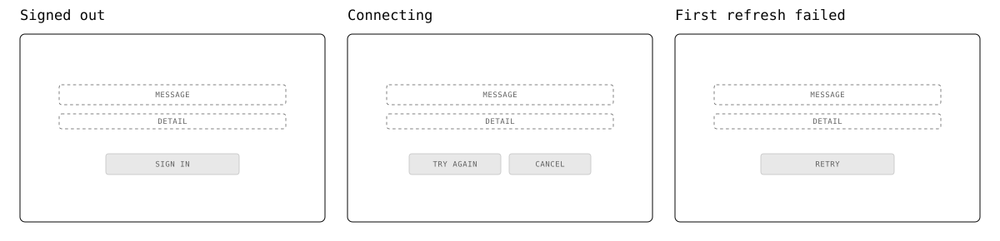

# Features

See the [README](../README.md) for installation and shortcuts.

## Browse and search

`net` opens the window. `net <query>` starts with a filter. The search field has focus, and Alfred selects the first result.

- Sites sort by publish time, newest first. Unpublished sites follow, sorted by creation time.
- Rows show the domain, repository or project name, thumbnail, and publish age. International domains use Unicode when valid.
- Failed, Building, Locked and Not published mark exceptions. A newer failed or building production deploy takes precedence over Locked.
- Search matches project names, domains, repositories and aliases. Words can appear in any order. Filters survive updates.
- Arrow keys move through results and wrap at either end. No matches hides the detail pane.
- Double-click or press Return to open a site. Opening or copying closes the window.
- Right-click a row to open its site, project or deploys, copy its URL, or sign out.

## Project and deploy details

**PROJECT** shows the name or deployment source, framework, functions, forms, domains and access warnings. Scheduled and edge functions count as functions. Missing stack information shows “Static site”.

**LATEST DEPLOY** shows the live deploy, unless a newer production deploy failed or is building. Details include the message, committer, local publish time, branch and short commit.

Failed and building deploys show their status and time. Locked means automatic publishing stopped. Unpublished sites show “Not published yet”.

## Previews

The preview first shows a cached picture: a local render, Netlify screenshot, or the workflow icon, in that order. It then loads the live page if the site allows embedding. Sites without a published deploy or URL have no preview.

- Blocked, unknown or unreachable pages keep the picture visible.
- Selecting a site requests a new render. It takes no focus and plays no sound.
- ⌘[ and ⌘] move through preview history. Selecting another site resets history.
- Reload shows the picture while the page loads. Links inside the page do not change the address field.
- Failed pictures and favicons retry after 24 hours. The workflow removes old pictures and thumbnails in the background.

## Sign-in and account data

Click **Sign in to Netlify** and approve access in your browser. You do not need a personal token or client secret.

Alfred checks approval about every two seconds for up to five minutes. **Try again** replaces the attempt. **Cancel** stops it. Approval saves the token in Keychain, clears old account data, reopens the window and refreshes sites.

Denial, expiry and failures appear in the window. Failures after browser approval starts reopen the window, but timeouts do not. A rejected token hides cached sites and asks you to sign in again.

Sign out removes the token and cached account data. Earlier jobs cannot restore them. Cancelled or replaced attempts cannot save a token. The window reports sign-out failures.

Updates keep the Keychain token. A changed signing identity can prompt for access once. Tokens never appear in process arguments or logs.

## Refresh and errors

The window opens from cache and refreshes stale data in the background. Refresh includes all visible sites across teams.

Press **⌘R** or click **Refresh** to fetch immediately. The list stays usable. Search, selection and preview stay in place where possible.

Status shows the site count, cache age, or current work. If refresh fails, cached sites stay visible and the status tooltip shows the error. Without cached sites, the window offers **Retry**. Reopen the window or refresh to try again.

Signed-out, connecting, loading and error states replace the list with a message and controls. See [architecture](architecture.md) for cache, preview and diagnostic details.

## Settings

Change these in Alfred’s workflow configuration.

| Setting | Default | Behaviour |
|---|---|---|
| Keyword | `net` | Opens the window |
| Refresh after (minutes), `cache_minutes` | `5` | Empty, non-finite or non-positive values use five minutes |

Developers can set `netlify_demo` to an offline fixture folder. Demo mode disables sign-in, refresh and live previews.
